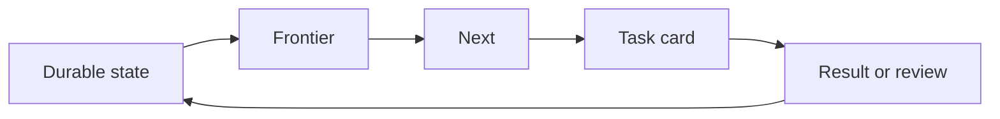
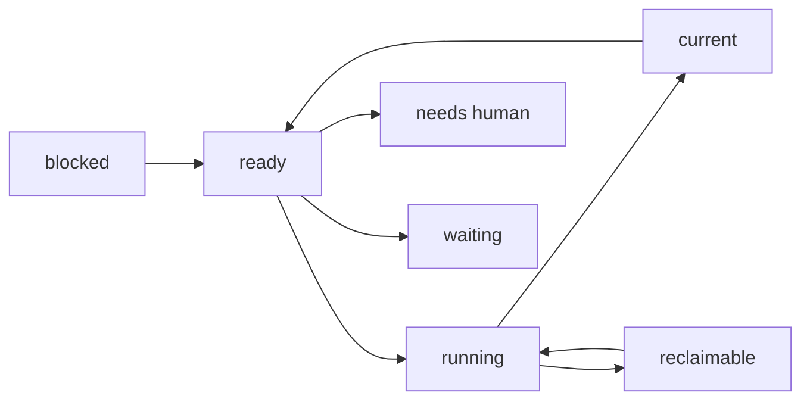
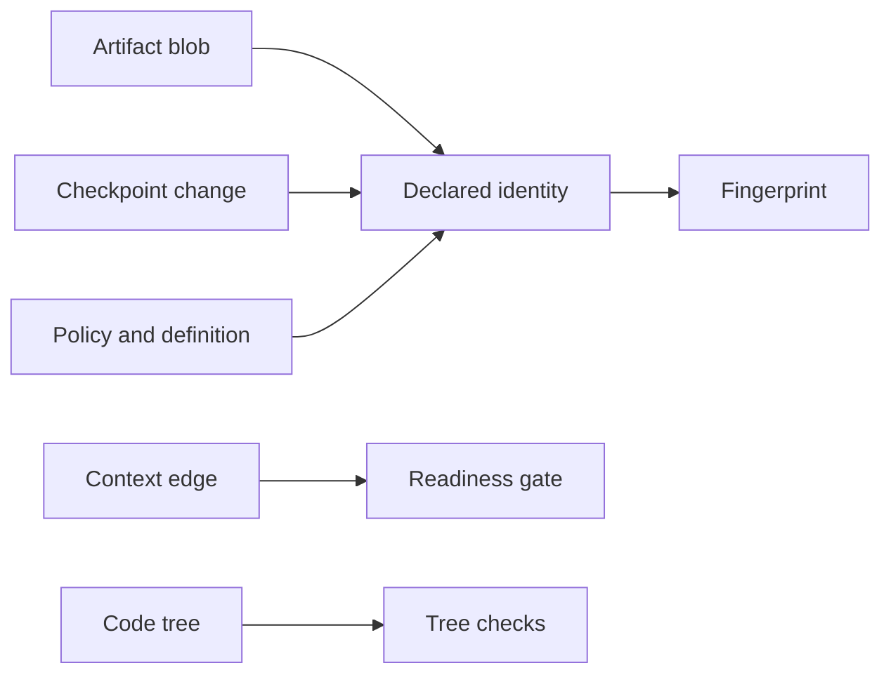

# Deterministic progressive disclosure in ZzzOps

**David Rzepa**

Working paper, 14 November 2026. Drafted and reviewed with AI agents.

Source commit: c455b09914b49fd65e169f91a4f79110e3e2540b

Package build: 0.0.0-dev d0738ea601d8

Checked date: 2026-11-14

Integration status: checked dev core

This paper describes a development snapshot, not an announcement of an official release. It is a working document for finding flaws as the design changes. [SPEC](design/SPEC.md) is the normative schema and algorithm reference; [DESIGN](design/DESIGN.md) records decisions and rationale. The [source ledger](#claim-and-evidence-ledger) binds material claims to immutable source and named tests. A test reference establishes only what that test actually checks.

## Contents

- [A workflow that discloses its next context](#a-workflow-that-discloses-its-next-context)
- [State, frontier and selection](#state-frontier-and-selection)
- [The task card](#the-task-card)
- [Identity, results and correction](#identity-results-and-correction)
- [A synthetic walkthrough](#a-synthetic-walkthrough)
- [Sync, delivery and recovery](#sync-delivery-and-recovery)
- [Authority and limits](#authority-and-limits)
- [Claim and evidence ledger](#claim-and-evidence-ledger)
- [Keeping this paper current](#keeping-this-paper-current)

## A workflow that discloses its next context

**Deterministic progressive disclosure** is the selection of work and its initial context from declared, durable workflow state. A computation identifies what is eligible now. A task card then gives a worker the particular prompt, inputs, instructions and pointers declared for that node. A result or review changes the state; the frontier is recomputed and a later worker sees context appropriate to that new state. The disclosure is progressive because different stages receive different material as their prerequisites become available. It is deterministic in the narrower sense that the frontier returns the same result for identical *complete* inputs, including time.



In prose: durable state is evaluated into a frontier; `next` presents actionable work; starting an agent produces a task card; its result or review is recorded; the next evaluation uses the resulting state. Nothing in this loop makes the worker's reasoning deterministic. The purpose is to make the handoff and its assumptions inspectable, including when work stops and resumes across sessions.

Consider a design that has been reviewed. A reviewer finds a missing constraint. The filter treats it as material, and the design node is reopened with the finding as a correction. The design worker receives the current input and correction, responds, and submits a new artifact. The changed subject causes review to run again. An approval follows only after its declared prerequisites are current. This is a change in the context of the next action, not a request that a single agent remember an entire conversation. The ledger identifies tests for these separate steps; the illustration is not evidence of a production run.

This mechanism aims to make long-running work easier to resume and audit, and to use limited attention on the current decision. It does not establish measured reliability, cost savings or correctness. It can be excessive for a small, immediately reviewable edit. It is insufficient where external actions require stronger isolation, authenticated identities, deployment controls or domain-specific review. A wrong workflow declaration can consistently select the wrong context.

Issue-tracker agents can retain durable tasks but differ in how explicitly they select each node's inputs. Orchestration frameworks can express graphs and dependencies; this design ties a particular frontier, record identity and review process to repository-owned state. A single session can handle work without durable handoffs but depends more on the session's continuity. Retrieval can also be deterministic: the distinction here is declared workflow selection versus relevance-based or agent-chosen context selection, not a claim that retrieval must be random.

## State, frontier and selection

### Durable state and the snapshot

A repository's goal documents and records, artifact commits, lease refs, policy and workflow definitions give the engine durable material to inspect. A session fetches a snapshot before computing its view. Writes use expected refs and atomic compare-and-swap pushes; contention requires a fresh view and retry rather than assuming an old ref still holds. A creation request key permits a retry to recover the same goal after certain ambiguous remote responses. This is bounded recovery, not a general guarantee that arbitrary external effects happened exactly once. Git history supplies useful provenance, but is neither authenticated execution evidence nor tamper-proof against administrators. [C1]

The pure frontier receives preloaded goal, graph, dependency views, leases, settings and `now`; it does not fetch or read the clock itself. Topological and sorted iteration make the result repeatable for identical complete arguments. `next` applies portfolio ordering and rendering to that result. Git refs alone do not determine identical `next` output or cards: lease time, local rendering context, reader material, holder and attempt, paths and command prefix also matter. External tools, CI observations, generated prose and human choices remain outside the determinism claim. [C2]



The diagram is an overview, not a complete transition graph. Missing inputs can block a node; resolved inputs can make it ready; a lease makes it running; a successful current result can later become stale or reopen. Expiry can make a lease reclaimable. Waits and human decisions have their own conditions; skips and the exact precedence are described below.

| State | Typical trigger or meaning |
|---|---|
| `skipped` | The goal explicitly skips the node. |
| `blocked` | Required input or subject is unavailable, or a non-ok record has live findings. |
| `waiting` | A time, dependency-conflict or release gate wait applies. |
| `running` | A live lease exists, even if inputs no longer resolve. |
| `reclaimable` | A lease expired below the crash-loop cap and inputs resolve. |
| `ready` | New, stale, reopened, retrying or non-ok work should run. |
| `needs_human` | Approval, a human blocker, dispute or cap needs a decision. |
| `current` | A done, ok record matches its input fingerprint and has no reopening finding. |

These labels do not form a simple linear state machine. The engine checks skip first and a live lease before missing inputs. After missing inputs and release gates it considers expiry, new or stale records, blocked-record waits, live corrections, non-ok results and approvals. An expired lease with missing inputs is blocked rather than offered for reclaim. A live lease carries a fingerprint derived from recorded inputs when possible, even if current inputs cannot resolve. [C2]

A producer normally supplies a consumer only when it is current and ok. Declared dependency inputs can allow discovery from a reviewed dependency before that dependency has merged, while delivery waits for integration. An open or held dependency that can still produce the value is a **named wait**, not a dead end; a cancelled, invalid or otherwise incapable dependency may instead contribute to a stuck decision. A held goal is evaluated but offers no actions or human items. Release gates, priority, capacity and ordering further constrain what `next` offers; human items can be gathered for a decision together. Exact behavior depends on repository policy and declared capabilities. [C2, C9]

The shipped default graph at this snapshot has 15 nodes and multi-lens review; it is a default a repository may adopt, not a law that every repository has that graph. The historical fixtures used by some tests have different graphs. Installing an engine does not silently replace repository workflow or policy. [C7, C9]

### Reading the frontier as an audit record

The important question at each stage is not merely “what runs?” but “what declaration made that action eligible?” For a blocked node, inspect the named missing producer and whether the dependency can still supply the selected value. Optional or pending selectors have different meanings: an optional missing value can resolve to null in defined cases, while a pending dependency may deliberately expose “not yet” as a value. A named wait should end when its producer becomes available; an impossible dependency needs a decision instead. A hold suppresses dispatch without erasing the state that explains the goal. [C2]

A `ready (stale)` record reports the changed fingerprint parts, such as a selected input, declared policy value, subject, candidates or lenses. A `ready (reopened)` record instead has live corrections. A human approval is not a generic replacement for these distinctions: it is a node with its own subject and prerequisites. Recomputing after every recorded result makes a correction, a changed dependency and a human answer visible through the same declared structure, while retaining their different reasons. Operators should check the actual returned reason before inferring why work was selected. [C2, C3, C7]

## The task card

A start operation claims a particular eligible node and returns a card. In simplified form:

```text
node: implement                    # selected work
prompt: {summary: ..., read: ...}  # declared instructions and immutable blob
inputs: {design: {blob: ..., read: ...}, ...}
context: {changed: ..., previous: ..., corrections: ...}
workspace: <goal workspace>
commands: {submit: <exact command>, renew: <exact command>}
```

Actual fields depend on the node. The card selects instruction names and declared policy values, distinguishes semantic inputs from context edges, and can show changed, previous and correction views. Large content can be summarized while preserving an immutable read pointer; the worker can follow it for the full content. The command includes the lease attempt and actor needed for submission. The card is an initial disclosure, not an access-control boundary: a worker with repository access can inspect other material, and the card's displayed prompt does not itself become a fingerprint input. [C4]

Size is an explicit audit boundary. The card shrinker targets 4,096 canonical bytes, but a large `previous` value can remain after all shrink steps: `big_previous(4200)` yields 8,122 bytes at this binding. SPEC §3.14's heading describes a hard maximum more strongly than this behavior supports. Likewise `next` trims actions, human items and some advisory details, but one held goal plus 150 dependents yields 11,270 canonical bytes with 150 waiting entries and no actions or human items remaining. SPEC §3.15's 8,192-byte wording is not universally enforced. These are reproducible discrepancies, not claims about cost or performance; neither engine nor SPEC is changed here. [C4, C5]

## Identity, results and correction



In prose: artifact blobs, normalized checkpoint changes, selected definitions and declared policy values contribute to identity where specified. Context edges gate readiness without contributing to the usual input fingerprint. Tree-bound checks use the actual code tree; they can need another run even when a change-bound judgment carries. Selection of a subfield changes what is compared. [C3, C8]

An artifact is identified by its blob, while a whole checkpoint uses its normalized change identity. A checkpoint's selected tree or change subfield is instead compared as the selected value. The node definition fingerprint uses a semantic allowlist, and declared policy values enter separately. Review subjects use normalized output with responses dropped for that subject comparison; a finding's target fingerprint has its own full-output fence. Provenance such as holder, attempt, times and prompt blob does not normally enter identity. Prompt and instruction changes therefore do not automatically rerun a record merely because the card displays them. When a changed prompt or other omitted definition should force a rerun, the configured migration is to bump that node's `rev`. [C3]

This separation makes incremental work possible and makes omissions important. A context edge can stop a node from becoming ready, but changing that edge alone does not invalidate a completed record. A fingerprint match means that the *declared identity* is unchanged; it does not prove the reasoning, output, test coverage or undeclared dependencies correct. Audit the selected fields and edges, especially when an input matters semantically but was declared only as context. [C3]

### Review is another disclosure step

A finding identifies a target and the fingerprint of the output it addresses. The frontier first computes live findings, then node states. A stale agent or human review can carry an open finding while the target output remains the same; stale operation findings follow a different rule. With the applicable capability, a blocked target can retain its prior output for finding liveness while ordinary consumers still wait for its retry. This avoids losing a relevant correction merely because its target is temporarily blocked; it does not make the blocked output current to consumers. [C7]

Multi-lens reviews can run independently and feed a filter join. The filter's candidates include open finding IDs and material labels. A fresh filter may turn a non-material finding into a note; a material finding cannot be demoted this way. Notes do not reopen work. Kept findings become corrections for the target; a submit must address required findings, and disputes can return to review and then escalate to a human. Review independence is checked by holder-label comparison, not verified identity or independent infrastructure. Shared labels, credentials and common assumptions weaken the practical independence of review. [C6, C7]

Owner-question interviewing is a prompt and policy procedure, supported by durable blocked answers. It is not an oracle for deciding which questions a person would have wanted asked. Stage-specific round budgets, where the capability is enabled, count newly raised material-finding rounds, with specified exemptions including a base-only change with no checkpoint output and certain definition, candidate, lens and policy changes. They are distinct from lease crash loops, repeated blockers and dispute escalation; none is simply a universal count of retries. [C7]

## A synthetic walkthrough

The following is a composite of checked behaviors, not a recorded run. Assume two generic goals A and B, with B depending on A, and a workflow declaring B's discovery input from A's reviewed design and B's delivery input from A's integration. The exact node names in a repository can differ.

| Moment | Relevant state and reason | What the next worker receives |
|---|---|---|
| Initially | A design is `ready (new)`; B discovery is `blocked` on A's missing reviewed design. | A's card selects its goal, design prompt and instructions. |
| A design and review accepted, A not integrated | A's reviewed design is current and ok; B discovery can be `ready (new)`; B delivery remains blocked on a named dependency wait. | B's discovery card receives the declared reviewed design; a long input may be a summary with a blob read pointer. |
| A review raises a material finding and the filter joins | A's design becomes `ready (reopened)` while the finding remains live against its target fingerprint; downstream consumption waits for current output. | A's design retry card includes the correction and relevant prior context. |
| A submits a changed design and responses | The old finding no longer targets the new output; the review becomes `ready (stale)` on its changed subject. | The reviewer receives the new subject and review context; the filter must join the new candidates. |
| Fresh review and filter accept | The review and filter become current and ok; the human approval node is `needs_human (approve)` when its prerequisites resolve. | The approval item presents the decision context; after approval, declared downstream work can proceed. |

The dependency example is supported by [C2]; card shrinking and pointers by [C4]; the review join, reopening and re-review by [C7]. Each row assumes no unrelated missing input, hold, release gate or lease. In particular, “ready” here is not a promise that portfolio capacity will dispatch it immediately. An owner can inspect the graph and actual card to test those assumptions.

## Sync, delivery and recovery

Suppose the A design worker is interrupted while its lease is live. Its node is `running`; after expiry, with inputs still resolved and below the crash-loop cap, it is `reclaimable`. A new attempt claims it. A late submission from the superseded attempt is fenced by the engine. That fence prevents the stale engine write; it does not terminate the old process or isolate its filesystem. Worktree conflicts and external effects still require care. An offline or unknown lease view cannot establish a safe claim; read-only inspection can still be useful, and recovery needs a fresh authoritative view. [C6]

Now suppose an upstream sync changes the base of a workspace checkpoint. Carry is decided per eligible node and checkpoint, not by a blanket assertion that a merge was safe. In merge mode the engine checks relocation, scoped deltas and edited conflict resolutions against its conservative whole-file union conditions. A qualifying change-bound record can carry with its prior change identity while the actual tree is recomputed. A changed tree reruns tree-bound checks; the configured implementation-review base edge also causes sync-focused review. If a scoped delta changes or a resolution fails the predicate, that node is not carried; conflict or correction work remains. Frozen test paths constrain subsequent implementation, and the actual sync tree is used for checks. Legacy rebase carry has a separate replay-map rule. [C8]

A concrete paired case is a context-only upstream edit: a qualifying checkpoint and its change-bound reviews carry, but a changed tree makes checks run again. An interleaved or dropped conflict resolution fails the conservative predicate and cannot use that carry. These are checked cases, not evidence that every merge or manual resolution is safe. If inputs change during a run, re-evaluation and submission fences matter as much as the original card. [C6, C8]

Delivery can stack a dependent PR on an integrated dependency while preserving dependency-order merge. Git operations use expected-head checks and existing approval and check gates. Optional Git-flow release and hotfix lines select targets, sync or back-merge, and impose their configured gates. A recorded production merge is evidence of that Git operation; application deployment, artifact promotion and publication to users are separate procedures. A passing check does not itself authorize a merge. [C9]

## Authority and limits

| Authority | What it can establish | What it cannot establish |
|---|---|---|
| Engine checks | Declared fingerprints, leases, gates, expected refs and supported transitions at this binding. | Correct reasoning, complete declarations, process termination or external side-effect isolation. |
| Shipped defaults | A starting graph, prompts and capability requirements. | That an existing repository has adopted them; local policy remains authoritative. |
| Root and human procedures | Dispatch, owner answers, review and approvals under the chosen workflow. | Authenticated independence merely from different holder labels, or automatic correctness. |
| External systems | Observed GitHub and CI results when queried. | A deployment or user-visible publication merely from a Git merge record. |

Routing tiers advise dispatch and do not prove which model actually executed. Capability floors can refuse unsupported work; bootstrap and default-policy notices help adoption and review rather than silently rewriting policy. Availability, credentials, administrative Git changes and external services remain operational dependencies. An incomplete edge declaration or incorrect policy can yield a consistent but inappropriate next action. These limits are reasons to inspect the workflow and results, not claims that the mechanism supplies autonomous safety. [C6, C9]

## Claim and evidence ledger

The links below point to the exact source snapshot and named tests. Scope distinguishes engine behavior, shipped defaults and procedures. Tests demonstrate specific cases, not all possible inputs. Reproductions are run by the manual checker.

| ID and scope | Claim and limit | Source and named evidence |
|---|---|---|
| C1 engine | Snapshot and expected-ref writes; request-key recovery is bounded. | [SPEC §4.2–4.4](https://github.com/david-rzepa/zzzops/blob/c455b09914b49fd65e169f91a4f79110e3e2540b/docs/design/SPEC.md#42-fetch-and-snapshot); [IdempotentNewTests.test_push_that_landed_but_reported_remote_failure_is_recovered](https://github.com/david-rzepa/zzzops/blob/c455b09914b49fd65e169f91a4f79110e3e2540b/.agents/test_engine_store.py) |
| C2 engine | Pure frontier, dependencies and named waits; complete inputs include time. | [SPEC §4.9](https://github.com/david-rzepa/zzzops/blob/c455b09914b49fd65e169f91a4f79110e3e2540b/docs/design/SPEC.md#49-frontier-two-passes-ok-semantics); [DependencyTests.test_held_dependency_is_a_wait_not_stuck](https://github.com/david-rzepa/zzzops/blob/c455b09914b49fd65e169f91a4f79110e3e2540b/.agents/test_engine_portfolio.py); [FrontierTests.test_live_lease_renders_running_and_expired_is_reclaimable](https://github.com/david-rzepa/zzzops/blob/c455b09914b49fd65e169f91a4f79110e3e2540b/.agents/test_engine_frontier.py) |
| C3 engine | Selected identity and omitted context; equality is not correctness. | [SPEC §4.8](https://github.com/david-rzepa/zzzops/blob/c455b09914b49fd65e169f91a4f79110e3e2540b/docs/design/SPEC.md#48-fingerprints); [FrontierTests.test_context_edge_change_stales_nothing](https://github.com/david-rzepa/zzzops/blob/c455b09914b49fd65e169f91a4f79110e3e2540b/.agents/test_engine_frontier.py); [IdentityTests.test_change_survives_clean_rebase_and_changes_after_conflict](https://github.com/david-rzepa/zzzops/blob/c455b09914b49fd65e169f91a4f79110e3e2540b/.agents/test_engine_identity.py) |
| C4 engine | Card selection and shrink target; `previous` can exceed it. | [SPEC §4.20](https://github.com/david-rzepa/zzzops/blob/c455b09914b49fd65e169f91a4f79110e3e2540b/docs/design/SPEC.md#420-task-card-construction); [ShrinkBudgetTests.test_a_card_over_budget_because_of_previous_is_a_fixed_point](https://github.com/david-rzepa/zzzops/blob/c455b09914b49fd65e169f91a4f79110e3e2540b/.agents/test_engine_card_budget.py); `card-previous` reproduction. |
| C5 engine | `next` truncation is not a universal bound. | [SPEC §3.15](https://github.com/david-rzepa/zzzops/blob/c455b09914b49fd65e169f91a4f79110e3e2540b/docs/design/SPEC.md#315-next-output-at-most-8192-bytes-unless---all); [RenderTests.test_truncation_keeps_under_8k](https://github.com/david-rzepa/zzzops/blob/c455b09914b49fd65e169f91a4f79110e3e2540b/.agents/test_engine_portfolio.py); `next-waiting` reproduction. |
| C6 engine | Reclaim fences an old submit; labels and fences do not isolate actors. | [SPEC §4.12](https://github.com/david-rzepa/zzzops/blob/c455b09914b49fd65e169f91a4f79110e3e2540b/docs/design/SPEC.md#412-leases-claim-renew-reclaim-abandon-orphans-capacity); [LeaseTests.test_submit_after_reclaim_is_fenced](https://github.com/david-rzepa/zzzops/blob/c455b09914b49fd65e169f91a4f79110e3e2540b/.agents/test_engine_lifecycle.py); [LeaseTests.test_independence_and_held_goal](https://github.com/david-rzepa/zzzops/blob/c455b09914b49fd65e169f91a4f79110e3e2540b/.agents/test_engine_lifecycle.py) |
| C7 default | Multi-lens join and corrections; material-round rules and held output are capability-dependent. | [SPEC §4.9](https://github.com/david-rzepa/zzzops/blob/c455b09914b49fd65e169f91a4f79110e3e2540b/docs/design/SPEC.md#49-frontier-two-passes-ok-semantics); [ReviewJourneyTests.test_design_reviewers_run_in_parallel_and_reopen_the_design_once](https://github.com/david-rzepa/zzzops/blob/c455b09914b49fd65e169f91a4f79110e3e2540b/.agents/test_engine_review_lenses.py); [RoundBudgetTests.test_base_only_exemption_requires_no_checkpoint_output](https://github.com/david-rzepa/zzzops/blob/c455b09914b49fd65e169f91a4f79110e3e2540b/.agents/test_engine_round_budget.py); [HeldOutputTests.test_carrier_and_filter_are_fresh_but_consumers_still_wait](https://github.com/david-rzepa/zzzops/blob/c455b09914b49fd65e169f91a4f79110e3e2540b/.agents/test_engine_blocked_findings.py) |
| C8 engine | Scoped carry can preserve change-bound work while tree checks rerun; unsafe resolutions refuse carry. | [SPEC §4.21](https://github.com/david-rzepa/zzzops/blob/c455b09914b49fd65e169f91a4f79110e3e2540b/docs/design/SPEC.md#421-carry-forward-across-a-clean-sync); [CleanSyncIdentityTests.test_context_sync_carry_loop_preserves_reviews_and_reruns_tree_checks](https://github.com/david-rzepa/zzzops/blob/c455b09914b49fd65e169f91a4f79110e3e2540b/.agents/test_engine_clean_sync.py); [CleanSyncIdentityTests.test_interleaved_and_dropped_resolutions_fail_closed](https://github.com/david-rzepa/zzzops/blob/c455b09914b49fd65e169f91a4f79110e3e2540b/.agents/test_engine_clean_sync.py) |
| C9 procedure | Delivery, optional lines and adoption have explicit gates; production merge does not prove deployment. | [SPEC §5](https://github.com/david-rzepa/zzzops/blob/c455b09914b49fd65e169f91a4f79110e3e2540b/docs/design/SPEC.md#5-operations); [TargetTests.test_release_goal_bases_integrates_and_merges_on_the_release_branch](https://github.com/david-rzepa/zzzops/blob/c455b09914b49fd65e169f91a4f79110e3e2540b/.agents/test_engine_branching.py); [DefaultComparisonTests.test_changed_prompt_has_working_diff_and_merge_commands](https://github.com/david-rzepa/zzzops/blob/c455b09914b49fd65e169f91a4f79110e3e2540b/.agents/test_engine_defaults.py) |

## Keeping this paper current

Choose a fresh source snapshot and inspect engine, template and capability changes. Update affected claims, ledger rows, synthetic examples and discrepancy status; compute the matching package build. Run `python3 .agents/whitepaper_check.py` and the relevant named behavior tests, inspect the result and refresh the blog where its claims changed. The manual checker validates references and builds and reproduces the two boundaries; it cannot decide whether a test semantically supports a sentence. Preserve older pins when explaining historical behavior. The repository's release and approval checks remain separate from this documentation audit.

<!-- whitepaper-ledger
[
  {
    "id": "C1",
    "family": "snapshot",
    "scope": "engine",
    "source": [
      {
        "path": "docs/design/SPEC.md",
        "section": "4.4"
      }
    ],
    "evidence": [
      {
        "path": ".agents/test_engine_store.py",
        "symbol": "IdempotentNewTests.test_push_that_landed_but_reported_remote_failure_is_recovered"
      }
    ],
    "limit": "Recovery applies to matching creation requests."
  },
  {
    "id": "C2",
    "family": "frontier",
    "scope": "engine",
    "source": [
      {
        "path": "docs/design/SPEC.md",
        "section": "4.9"
      }
    ],
    "evidence": [
      {
        "path": ".agents/test_engine_portfolio.py",
        "symbol": "DependencyTests.test_held_dependency_is_a_wait_not_stuck"
      }
    ],
    "limit": "Complete inputs include now; scheduling adds constraints."
  },
  {
    "id": "C3",
    "family": "identity",
    "scope": "engine",
    "source": [
      {
        "path": "docs/design/SPEC.md",
        "section": "4.8"
      }
    ],
    "evidence": [
      {
        "path": ".agents/test_engine_frontier.py",
        "symbol": "FrontierTests.test_context_edge_change_stales_nothing"
      }
    ],
    "limit": "Declared identity is not correctness."
  },
  {
    "id": "C4",
    "family": "cards",
    "scope": "engine",
    "source": [
      {
        "path": "docs/design/SPEC.md",
        "section": "4.20"
      }
    ],
    "evidence": [
      {
        "path": ".agents/test_engine_card_budget.py",
        "symbol": "ShrinkBudgetTests.test_a_card_over_budget_because_of_previous_is_a_fixed_point"
      },
      {
        "reproduction": "card-previous"
      }
    ],
    "limit": "Large previous data can exceed the target."
  },
  {
    "id": "C5",
    "family": "next",
    "scope": "engine",
    "source": [
      {
        "path": "docs/design/SPEC.md",
        "section": "3.15"
      }
    ],
    "evidence": [
      {
        "path": ".agents/test_engine_portfolio.py",
        "symbol": "RenderTests.test_truncation_keeps_under_8k"
      },
      {
        "reproduction": "next-waiting"
      }
    ],
    "limit": "Waiting entries can exceed the target."
  },
  {
    "id": "C6",
    "family": "leases",
    "scope": "engine",
    "source": [
      {
        "path": "docs/design/SPEC.md",
        "section": "4.12"
      }
    ],
    "evidence": [
      {
        "path": ".agents/test_engine_lifecycle.py",
        "symbol": "LeaseTests.test_submit_after_reclaim_is_fenced"
      }
    ],
    "limit": "Fencing does not terminate processes."
  },
  {
    "id": "C7",
    "family": "review",
    "scope": "default",
    "source": [
      {
        "path": "docs/design/SPEC.md",
        "section": "4.9"
      }
    ],
    "evidence": [
      {
        "path": ".agents/test_engine_review_lenses.py",
        "symbol": "ReviewJourneyTests.test_design_reviewers_run_in_parallel_and_reopen_the_design_once"
      }
    ],
    "limit": "Review and capability configuration differ by repository."
  },
  {
    "id": "C8",
    "family": "sync",
    "scope": "engine",
    "source": [
      {
        "path": "docs/design/SPEC.md",
        "section": "4.21"
      }
    ],
    "evidence": [
      {
        "path": ".agents/test_engine_clean_sync.py",
        "symbol": "CleanSyncIdentityTests.test_context_sync_carry_loop_preserves_reviews_and_reruns_tree_checks"
      }
    ],
    "limit": "Carry is per checkpoint and conservative."
  },
  {
    "id": "C9",
    "family": "delivery",
    "scope": "procedure",
    "source": [
      {
        "path": "docs/design/SPEC.md",
        "section": "5.1"
      }
    ],
    "evidence": [
      {
        "path": ".agents/test_engine_branching.py",
        "symbol": "TargetTests.test_release_goal_bases_integrates_and_merges_on_the_release_branch"
      }
    ],
    "limit": "Git merge does not establish deployment."
  }
]
-->
