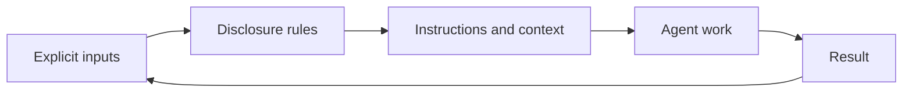
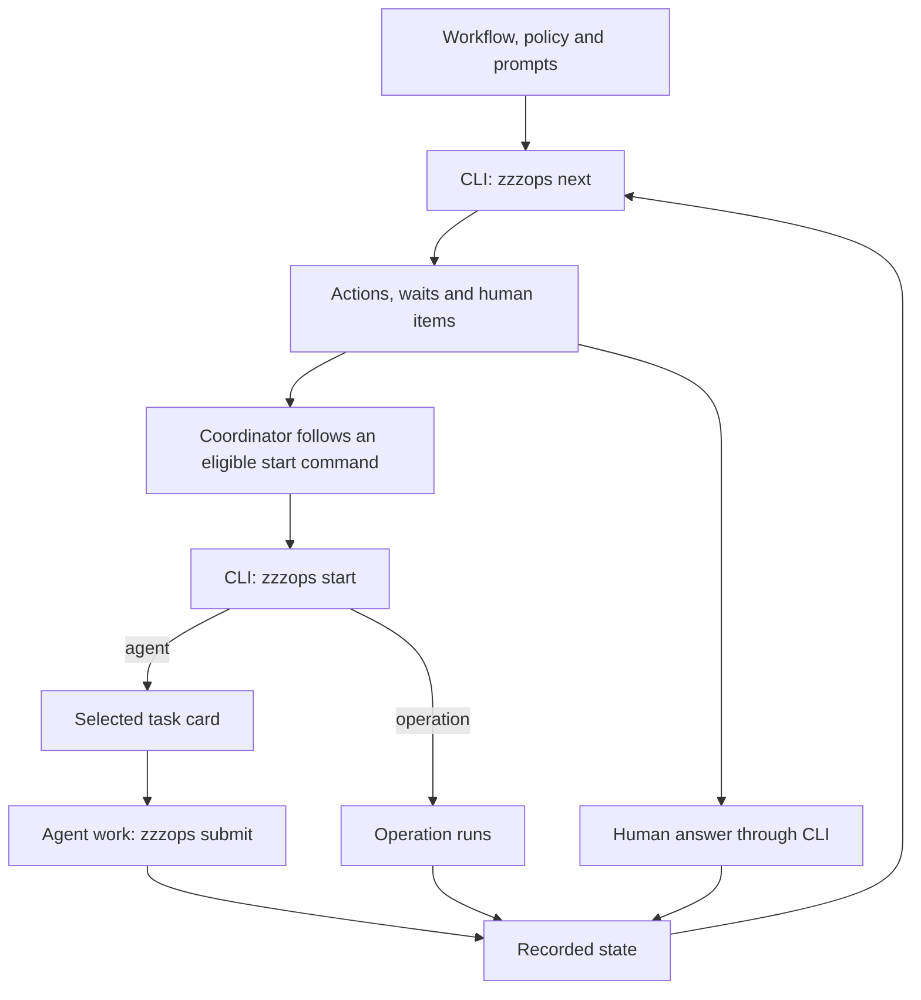

# Deterministic progressive disclosure for agentic software

**David Rzepa**

14 November 2026

## Abstract

Deterministic progressive disclosure is the selective delivery of prompts when explicit, software-evaluated conditions are satisfied. The software determines when each prompt becomes available, rather than giving an agent all prompts upfront or letting it decide which prompts to discover and load. The pattern separates coordination—what work is eligible and what context to provide—from judgment about how to perform that work. ZzzOps illustrates the idea with a mostly unopinionated engine that interprets a customizable, repository-owned workflow, policy and prompts. Its frontier can expose several eligible actions, supporting independent parallel work and task-specific model choices. This paper develops the concept, illustrates its application and proposes further uses.

## Motivation

An agent needs more than a request. It may need earlier results, source material, instructions, a policy or a human decision. Choosing which of these to provide, and when, is part of the application's design even when that choice is left implicit.

An agent can discover its own next task and retrieve the information it considers relevant. This is useful when the route through a problem is unknown. For a known process, however, it also asks the agent to reconstruct procedural decisions that a designer or owner could state directly. A long conversation preserves history without necessarily identifying what is actionable now.

Deterministic progressive disclosure makes those coordination choices explicit. Software constructs a handoff from declared inputs and rules. The agent uses judgment within it: analyzing sources, writing a design or finding an error. Results then become inputs to later handoffs. Recorded state can preserve this arrangement across interrupted sessions, so work need not depend on one continuous chat.

The idea applies beyond workflow engines. A user choice, a tool result or an application's state might select a prompt, a collection of documents or a tool configuration. Git and task graphs are possible implementation choices, rather than requirements of the concept.

## The pattern

A disclosure rule maps explicit inputs to information and instructions for an agent. The same rule applied to the same complete inputs selects the same disclosure. Those inputs include any configuration, time or external results on which the rule depends. The agent's reasoning and the systems producing the inputs can still vary.

In prose, rules select a handoff from explicit inputs; the agent works with it; the result can inform another selection. Disclosure is progressive because the material provided can change as work proceeds.

For example, a research assistant might offer a short explanation or a detailed comparison. A user's choice selects the corresponding instructions alongside the source material. The agent interprets the sources and writes the response. If the choice changes, software supplies the new instructions. The rule makes the handoff explicit without prescribing the answer.

This division separates selection from judgment. A system can specify the essential context for a task while allowing the agent to explore further. A review can become an explicit correction input, and a human decision can determine which work becomes eligible. The process designer chooses which decisions belong in rules and which remain with people or agents.

The pattern also permits several handoffs at once. Where tasks have no unmet dependencies on one another, the same state can make each eligible with its own instructions. Determinism concerns how those handoffs are selected; it does not require a single sequence or one worker.

## Prior Work

Progressive disclosure in LLM agents commonly means loading instructions in stages. [Anthropic’s Agent Skills](https://www.anthropic.com/research/equipping-agents-for-the-real-world-with-agent-skills) supplies skill names and descriptions initially; the model then decides which full instructions and supporting resources to read. Its [context-engineering discussion](https://www.anthropic.com/research/effective-context-engineering-for-ai-agents) also describes agents discovering relevant context through exploration. These approaches reduce initial loading while leaving later selection partly with the model. Instruction loading is the relevant comparison here; ordinary retrieval of task data is a broader concern.

Software-triggered instruction loading is also established. The [dotagents project](https://dotagents.io/) uses the exact phrase “deterministic progressive disclosure” and advocates automatically including scoped instruction files when relevant files are touched. Its central distinction is the same one made here: the harness selects instructions from explicit conditions instead of relying on the model to request them. ZzzOps applies that principle to workflow eligibility and task prompts rather than file scope. This is a difference in application and triggering state, not evidence of a newly invented underlying mechanism.

[Building effective agents](https://www.anthropic.com/research/building-effective-agents) describes predefined LLM workflows, routing, parallelization and evaluator–optimizer patterns. These already provide software-directed sequences of task-specific prompts, although individual routing decisions may use a model. The proposed framing draws attention specifically to when prompts are supplied, what conditions select them, and which decisions remain with the agent. It does not claim to originate software-controlled prompting or the term used by dotagents.

## ZzzOps as an illustration

ZzzOps is repository-based goal and release management for coding agents. It serves repository owners and developers who need to coordinate goals, workers, reviews, checks and human decisions across sessions. Goals and results are recorded durably in Git, so a later participant can resume from explicit state. Its release support coordinates branches and merges; application deployment is handled separately. Here, ZzzOps illustrates how those records can drive the instructions and context given to agents.

Its architecture separates a mostly unopinionated coordination engine from an opinionated, repository-owned process. The engine interprets a workflow, policy and prompts. ZzzOps ships one default process; repositories can customize it.

The workflow is a **directed acyclic graph**, or DAG: tasks connected by prerequisite links with no dependency loops. A task might produce a design, review it or request approval. The repository chooses the supported tasks, dependencies, instructions, reviews and approval arrangements. The engine retains common rules for valid state, eligibility, result freshness and coordinated writes.

The shipped default takes a recorded goal through design, independent review and separate adversarial critique, then filtering and human design approval. Branch/base preparation leads to test design and test review, implementation, checks, and implementation review/filtering. Delivery requires an integration PR and human merge approval before merge. This is a dependency graph, not a fixed serial script: design review and adversarial critique can run together, and PR integration and merge approval can become eligible alongside each other. Findings can reopen earlier work.

`zzzops next` is the first disclosure: the CLI computes a **frontier**—a view of what can proceed and what must wait—and returns eligible actions, waits, human items and exact start commands. Several actions can be eligible together; capacity and shared-workspace limits constrain which can be started. A compact view may omit some. This overview identifies the work without returning its full task instructions.

The coordinator follows an eligible action's `zzzops start` command. For an agent task, the CLI returns a task card with the selected prompt, instructions, declared inputs and context, pointers, and exact submit/renew commands. For an operation, start runs that operation instead of returning an agent card. Human decisions remain explicit CLI items to answer.

After agent work, `zzzops submit` records the result and changes state; operations and human answers also update state. The coordinator calls next again. The software selects the disclosures, and the coordinator dispatches the indicated work. The diagram shows these CLI handoffs while the repository's configuration continues to supply the process choices.

This separation makes deterministic disclosure reusable without imposing one rigid process. Two repositories can declare different workflows and obtain different handoffs from the same engine. “Mostly unopinionated” describes that separation of mechanism from process choices; the engine still makes assumptions and enforces constraints.

Eligible agent actions carry a capability requirement, and their task cards list configured model suggestions for that requirement. This gives the coordinator a basis for choosing models task by task. The coordinator or agent harness chooses and launches workers; the engine supplies eligibility and guidance rather than autonomously dispatching models or verifying which model ran.

Suppose one review finds a missing constraint. The finding enters the recorded state, and the configured review process can reopen the design with that correction in its task card. After a revised design is submitted, the relevant review runs again. The workflow can then present the configured approval to a person. This synthetic example shows the loop: state determines eligible work; cards give clear instructions and context; results and decisions change the state; eligibility and disclosure are computed again.

The agent contributes design and review judgment. The engine coordinates the declared process and preserves its handoffs. This supports durable work, visible human decisions and critique followed by correction, while leaving the repository responsible for the process it defines.

## Discussion

Explicit rules trade implicit flexibility for design and maintenance work. They can omit relevant context, select unsuitable instructions or encode poor process choices. A repeatable selection does not establish that the selection is good, that an agent reasons correctly or that a review finds every flaw. Benefits in clarity, continuity or efficient use of attention remain design aims here.

Agent-led exploration remains useful when the route and sources are unknown. A short task may need only a simple handoff. These approaches can coexist: software can assign an exploratory task and use its result as an explicit input to later rules. The useful boundary depends on what the application can specify and what it needs an agent to discover.

Parallel eligibility also needs resource and coordination decisions. Independent tasks may compete for limited capacity or shared files, and model suggestions do not establish model suitability. ZzzOps' cards are selective initial context, not a security boundary. Its records and checks coordinate work under declared assumptions; they do not replace permissions, human authority or controls over external actions. Customizing the process brings responsibility for reviewing and maintaining those assumptions.

## Future Work

For this design and ZzzOps, useful next directions include applying or refining established techniques in the following settings. These are development possibilities, rather than claims of unprecedented methods or implemented features.

**Parallel orchestration and model routing.** A coordinator could use eligible tasks, capability requirements and explicit resource rules to automate scheduling and task-model choices. ZzzOps already exposes multiple actions and model guidance; richer automated routing would build on that support.

**Research and evidence workflows.** Rules could disclose different instructions as sources arrive, analyses disagree or an uncertainty threshold is reached. One task might compare claims while another gathers missing material, with their results informing a later synthesis.

**State-adaptive assistants.** User-facing software could choose instructions from explicit user choices, completed steps or application state. An assistant could receive the context appropriate to the current interaction without having to infer every procedural decision from conversation history.

**Human decision handoffs.** Systems could construct a decision request from the current alternatives and relevant context, pause the affected work, and use the recorded answer to select subsequent disclosures. This could make the relationship between human authority and agent work more visible.

Each direction raises a shared design question: which inputs and rules should control the handoff, and where should judgment remain open?

## Conclusion

Deterministic progressive disclosure puts the selection of an agent's instructions and context into explicit software rules. It can support changing handoffs, multiple eligible tasks and different process choices while preserving room for agent judgment. ZzzOps illustrates one application through a reusable coordination engine and a customizable repository process. The broader proposal is a way to design the boundary between software coordination, human decisions and agent work.

## Implementation note

The ZzzOps illustration refers to [ZzzOps 3.0.0, tag `v3.0.0`](https://github.com/david-rzepa/zzzops/releases/tag/v3.0.0), published from immutable commit [`ed91d6c64b45e9c5d97ff883fae395b540a8733e`](https://github.com/david-rzepa/zzzops/tree/ed91d6c64b45e9c5d97ff883fae395b540a8733e), package build `3.0.0 e4cf74f4b756`. [SPEC](https://github.com/david-rzepa/zzzops/blob/ed91d6c64b45e9c5d97ff883fae395b540a8733e/docs/design/SPEC.md) gives the implementation contract, and [DESIGN](https://github.com/david-rzepa/zzzops/blob/ed91d6c64b45e9c5d97ff883fae395b540a8733e/docs/design/DESIGN.md) records its rationale.
