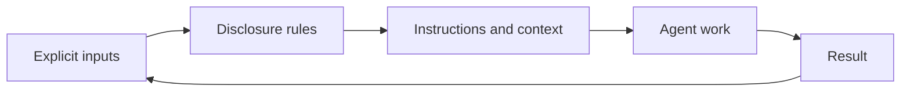
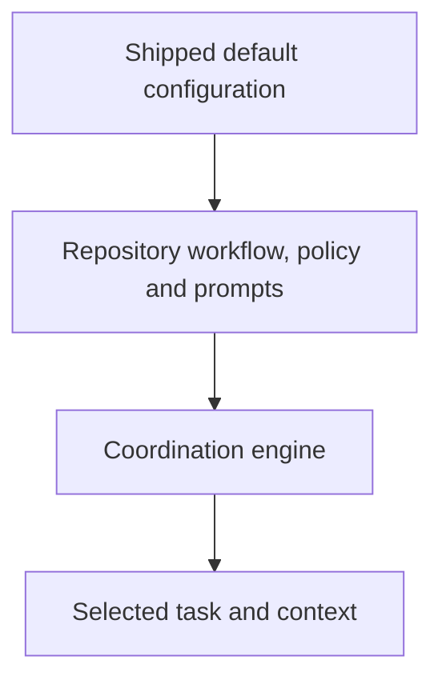

# Deterministic progressive disclosure for agentic software

**David Rzepa**

14 November 2026 · Working paper · Drafted and reviewed with AI agents

## Abstract

Deterministic progressive disclosure is an architectural pattern in which deterministic software selects the information and instructions an agent receives according to explicit inputs and rules, rather than leaving disclosure decisions to the agent's own reasoning. It addresses a recurring design problem in agentic software: an agent needs enough context to perform its present task, while the system must decide which task and context to provide as work changes. The pattern separates those coordination decisions from the agent's judgment about how to do the work. ZzzOps illustrates the pattern by using a general coordination engine to interpret a repository-owned workflow, policy and prompts. The engine gives agents instructions for progressing through that defined workflow; the workflow itself can be customized. This paper presents a design argument and an illustration, not an experimental evaluation.

## Motivation

An agent rarely starts with exactly the information it needs. It may need a user's request, an earlier analysis, the result of a tool, a policy, or a review of its previous work. Someone or something must decide which of these to provide, when to provide it, and what the agent should do next. That decision is part of the software's design even when it is left implicit.

One approach asks the agent to discover both its task and the context needed to perform it. This can be useful when the route through a problem is unknown. For work that follows a known process, however, the same approach also asks the agent to reconstruct procedural choices that the system's designer or owner could state directly. If a session ends, its successor may have to infer those choices again. A long transcript can preserve words without making the current task, its prerequisites and the relevant decisions easy to identify.

Deterministic progressive disclosure proposes a different division of labor. Software applies explicit rules to explicit inputs and constructs a handoff for the current task. The agent uses judgment within that handoff: it can analyze an artifact, write a design, find an error or propose a correction. The system can then use the resulting state to select another handoff. The design aims to make coordination legible and repeatable, while preserving room for judgment where the work requires it.

The proposal is broader than a workflow engine. Its inputs might be a user choice, the return value of a tool, a stage in an application, or a record of prior work. The output might be a prompt, a set of documents, a tool configuration or a combination of instructions and data. The defining feature is that software, following explicit rules, selects the disclosure; it is not necessary for the whole application to use Git or a task graph.

## The pattern

A disclosure rule maps an explicit input to information and instructions for an agent. If the same rule receives the same complete input, it selects the same disclosure. When the input changes, the rule may select a different disclosure. “Complete” matters: a rule that depends on time, configuration or a tool result has those values among its inputs, even if a reader initially sees only a user's request.

In prose, explicit inputs enter disclosure rules, which select a handoff. The agent works with that handoff and produces a result; that result can become an input to a later selection. The loop describes coordination. It does not require the agent's reasoning or the producers of the inputs to be deterministic.

For example, imagine a research assistant application that asks a user whether they want a short explanation or a detailed comparison. A rule sends the same source material to either route, but supplies instructions for a concise explanation in the first case and a comparison template in the second. If the user changes the selection, the application sends the corresponding instructions. The agent still decides how to interpret the sources and write the response. The software has made one disclosure decision explicit without prescribing the entire answer.

The pattern is progressive because disclosure can change as work proceeds. A result can select a follow-up task, a review can call for a correction, and a human choice can unlock another step. The system need not place every possible instruction and document in the first prompt. It can instead explain each next task in the context of the state that made it relevant. This is an architectural choice, not a promise that smaller handoffs are always better: a task may require broad context, and a rule must be designed to include it.

The pattern also makes a useful distinction between *selection* and *judgment*. The rule selects what the agent initially receives. It does not establish that the information is true or that the agent will reason well from it. Nor must it prevent further exploration. An application may give the agent tools or pointers to additional material, while still deciding the initial task and its essential inputs through explicit rules. The boundary between what is selected in advance and what an agent may explore is itself a design decision.

Durable state can extend this arrangement across interruptions. If a system records the request, result and outstanding decision in a form it can read later, it can construct the next handoff without depending on a single continuous conversation. Human authority can be expressed in the same way: a rule can present a decision to a person and use the recorded answer in subsequent work. Critique and correction fit the pattern too. A review finding can become an explicit input to a revised task rather than a comment the next agent must happen to recover from a transcript.

These ideas relate to other ways of coordinating agents. Issue trackers store tasks and decisions; orchestration frameworks express sequences and dependencies; retrieval systems select information for a query. Retrieval can itself be deterministic. The distinction here is the explicit use of inputs and rules to select the agent's handoff, rather than a claim that other approaches are random or cannot support durable work. A system may combine deterministic disclosure with retrieval or agent-led exploration.

## ZzzOps as an illustration

ZzzOps applies the pattern to software work that can span multiple sessions and participants. Its central architectural choice is to separate a mostly unopinionated coordination engine from an opinionated, repository-owned process. The engine interprets a workflow, policy and prompts. ZzzOps ships one opinionated default, while a repository can customize its process within the engine's constraints.

A workflow is represented as a **directed acyclic graph**, or DAG: a set of tasks connected by prerequisite links, arranged so that no chain of dependencies loops back on itself. A task might produce a design, review it or request approval. A link states that some work or information must be available before another task can proceed. The graph makes those relationships explicit; it does not require every repository to choose the same tasks or review sequence.

In prose, the engine applies its coordination rules to a repository's workflow, policy and prompts to select a task and its context. The shipped default is one starting configuration for that repository-owned layer. Changing the configuration does not replace the engine's coordination invariants.

The engine is not assumption-free. It enforces rules about valid workflow state, which tasks are eligible, when recorded results are current, and how concurrent writes are coordinated. Those invariants give the process a common execution model. The repository layer supplies process choices: tasks and their dependencies, selected instructions and inputs, review arrangements, and approval choices supported by the engine. A team can therefore adopt the shipped default or adapt those choices to its work, while remaining responsible for the process it declares.

This separation is important to deterministic progressive disclosure. Deterministic selection does not imply one rigid process for every team. Two repositories can declare different workflows and receive different handoffs; within each, the engine applies explicit rules to the declared state. The reusable part is the way coordination is computed and recorded. The opinionated part is the process the computation interprets. This division aims to let teams inspect and change process choices without building a new coordination engine for each one.

Consider a synthetic design task. The repository's workflow calls for a design, an independent review and a decision before later delivery work. The goal and the workflow are durable state. The engine computes a **frontier**: a view of what can proceed and what must wait given the current state. Initially, a design task can be ready while review waits for its input. The system presents the next eligible task and, when a worker claims it, gives the worker a task card containing the selected prompt, instructions, inputs and pointers for that task.

The worker submits a design. The state has changed, so the engine recomputes the frontier. The review can now receive the design and its review instructions. Suppose the reviewer identifies a missing constraint. The finding is recorded against the output it concerns, and the configured review process determines whether it requires correction. A subsequent frontier can reopen the design task with that finding included in its card. The design worker responds and submits a revised artifact; the review then considers the changed subject. When the required work is current, the workflow can present the configured approval to a person.

This sequence is an illustration, not a claim about a particular completed project. Its purpose is to show how the task card connects the general pattern to a defined process: state selects a frontier; the frontier supports a next action; the card gives clear instructions and context; a result or review changes the state; and the selection is computed again. The agent contributes design and review judgment. The engine supplies the declared progression and the handoffs between those judgments.

The handoff is selective, not a security boundary. A card can contain a short view and a pointer to fuller material, and a worker with access may inspect more. Some information gates whether work is ready without being part of the identity used to decide whether an old result is still current. These distinctions allow different kinds of coordination, but they also make the workflow author's declarations consequential. The appendix points to the specification for the precise behavior.

## Discussion

The general pattern trades implicit flexibility for explicit design work. A rule can omit a source that matters, select an unsuitable instruction, or encode a poor interpretation of the user's goal. Repeating that selection consistently does not make it good. Inputs can be incomplete or wrong; an agent can misunderstand them; a review can miss a flaw. The anticipated gains in clarity, continuity or efficient use of attention are design aims, not results established by this paper.

Agent-led disclosure remains useful when a problem is open-ended and the needed sources or sequence are not known in advance. A simple handoff may be sufficient for a short task with one participant. These approaches can coexist with deterministic selection: a system can give an agent a defined exploratory task, allow it to find material, and use its recorded result as an explicit input to a later rule. The appropriate boundary depends on what the application can specify and what it wants the agent to discover.

ZzzOps adds implementation-specific limits. Its coordination rules and repository declarations do not guarantee correct reasoning, independent human or agent judgment, secure process isolation, or the success of external actions. A result may appear current under the declared inputs even when a relevant input was omitted. Rejecting an outdated submission does not stop the process that produced it. Git records provide useful history, but they do not by themselves authenticate every action or prove deployment to users. A repository that customizes its workflow must maintain and review those choices, and different configurations can make comparisons between projects harder.

These limits also identify what to inspect. Are the task and essential context selected from the right inputs? Does a change that matters cause the appropriate work to be reconsidered? Is a human decision presented where authority belongs? Can a reviewer understand what is being reviewed and what follows a finding? The value of explicit rules is that these questions can be asked about a concrete design, even though answering them still requires judgment.

## Conclusion

Deterministic progressive disclosure places the selection of an agent's instructions and context in explicit software rules, while leaving the agent to exercise judgment within the resulting task. As inputs and results change, the system can disclose the next relevant handoff. The pattern applies to many forms of agentic software and does not require a fixed workflow or a particular storage system.

ZzzOps illustrates one application: a mostly unopinionated engine interprets a customizable, opinionated repository process and gives workers instructions for moving through it. Separating coordination invariants from process choices makes deterministic disclosure compatible with different ways of working. The design's usefulness depends on the quality of those choices and on the people and agents who carry them out.

## Appendix: source and evidence

The illustration describes the checked development core, not an official release. The exact algorithms and schemas are in [SPEC](design/SPEC.md); [DESIGN](design/DESIGN.md) records rationale. The sources and tests below are pinned to the stated commit. Named tests support particular cases, not every possible input.

Source commit: c455b09914b49fd65e169f91a4f79110e3e2540b

Package build: 0.0.0-dev d0738ea601d8

Checked date: 2026-11-14

Integration status: checked dev core

The manual checker also reproduces two discrepancies in the specification's size wording. A card with `big_previous(4200)` remains 8,122 canonical bytes despite a 4,096-byte target; a `next` view with one held goal and 150 dependents is 11,270 canonical bytes despite the 8,192-byte wording. These are implementation boundaries, not performance measurements. The checker validates referenced paths, symbols and builds; it cannot judge whether a source supports every sentence.

| Area | Source and example evidence | Boundary |
|---|---|---|
| Snapshot and recovery | [SPEC §4.4](https://github.com/david-rzepa/zzzops/blob/c455b09914b49fd65e169f91a4f79110e3e2540b/docs/design/SPEC.md#44-per-goal-compare-and-swap-write); [IdempotentNewTests.test_push_that_landed_but_reported_remote_failure_is_recovered](https://github.com/david-rzepa/zzzops/blob/c455b09914b49fd65e169f91a4f79110e3e2540b/.agents/test_engine_store.py) | Recovery concerns matching creation requests. |
| Frontier and dependencies | [SPEC §4.9](https://github.com/david-rzepa/zzzops/blob/c455b09914b49fd65e169f91a4f79110e3e2540b/docs/design/SPEC.md#49-frontier-two-passes-ok-semantics); [DependencyTests.test_held_dependency_is_a_wait_not_stuck](https://github.com/david-rzepa/zzzops/blob/c455b09914b49fd65e169f91a4f79110e3e2540b/.agents/test_engine_portfolio.py) | Complete frontier inputs include time. |
| Identity and context | [SPEC §4.8](https://github.com/david-rzepa/zzzops/blob/c455b09914b49fd65e169f91a4f79110e3e2540b/docs/design/SPEC.md#48-fingerprints); [FrontierTests.test_context_edge_change_stales_nothing](https://github.com/david-rzepa/zzzops/blob/c455b09914b49fd65e169f91a4f79110e3e2540b/.agents/test_engine_frontier.py) | Identity is not correctness. |
| Cards and `next` | [SPEC §4.20](https://github.com/david-rzepa/zzzops/blob/c455b09914b49fd65e169f91a4f79110e3e2540b/docs/design/SPEC.md#420-task-card-construction); [ShrinkBudgetTests.test_a_card_over_budget_because_of_previous_is_a_fixed_point](https://github.com/david-rzepa/zzzops/blob/c455b09914b49fd65e169f91a4f79110e3e2540b/.agents/test_engine_card_budget.py); [RenderTests.test_truncation_keeps_under_8k](https://github.com/david-rzepa/zzzops/blob/c455b09914b49fd65e169f91a4f79110e3e2540b/.agents/test_engine_portfolio.py) | The two size reproductions above show exceptions. |
| Leases and review | [LeaseTests.test_submit_after_reclaim_is_fenced](https://github.com/david-rzepa/zzzops/blob/c455b09914b49fd65e169f91a4f79110e3e2540b/.agents/test_engine_lifecycle.py); [ReviewJourneyTests.test_design_reviewers_run_in_parallel_and_reopen_the_design_once](https://github.com/david-rzepa/zzzops/blob/c455b09914b49fd65e169f91a4f79110e3e2540b/.agents/test_engine_review_lenses.py) | Fencing does not stop processes; review does not prove correctness. |
| Configurable process | [DESIGN §2.2](https://github.com/david-rzepa/zzzops/blob/c455b09914b49fd65e169f91a4f79110e3e2540b/docs/design/DESIGN.md#22-graph-engine-b); [RenamedReviewJourneyTests.test_renamed_graph_journey](https://github.com/david-rzepa/zzzops/blob/c455b09914b49fd65e169f91a4f79110e3e2540b/.agents/test_engine_review_lenses.py); [ShippedTemplateTests.test_the_15_node_graph](https://github.com/david-rzepa/zzzops/blob/c455b09914b49fd65e169f91a4f79110e3e2540b/.agents/test_engine_review_lenses.py) | Repositories may choose different supported definitions. |
| Sync and delivery | [CleanSyncIdentityTests.test_context_sync_carry_loop_preserves_reviews_and_reruns_tree_checks](https://github.com/david-rzepa/zzzops/blob/c455b09914b49fd65e169f91a4f79110e3e2540b/.agents/test_engine_clean_sync.py); [TargetTests.test_release_goal_bases_integrates_and_merges_on_the_release_branch](https://github.com/david-rzepa/zzzops/blob/c455b09914b49fd65e169f91a4f79110e3e2540b/.agents/test_engine_branching.py) | Carry has conditions; a Git merge does not prove deployment. |

For upkeep, choose a fresh source snapshot, inspect engine, template and capability changes, update affected statements and evidence, compute its package build, then run `python3 .agents/whitepaper_check.py` and relevant behavior tests. Update the blog if its claims change. Preserve older pins when describing historical behavior; ordinary release and approval checks remain separate.
<!-- whitepaper-ledger
[
  {
    "id": "C1",
    "family": "snapshot",
    "scope": "engine",
    "source": [
      {
        "path": "docs/design/SPEC.md",
        "section": "4.4"
      }
    ],
    "evidence": [
      {
        "path": ".agents/test_engine_store.py",
        "symbol": "IdempotentNewTests.test_push_that_landed_but_reported_remote_failure_is_recovered"
      }
    ],
    "limit": "Recovery applies to matching creation requests."
  },
  {
    "id": "C2",
    "family": "frontier",
    "scope": "engine",
    "source": [
      {
        "path": "docs/design/SPEC.md",
        "section": "4.9"
      }
    ],
    "evidence": [
      {
        "path": ".agents/test_engine_portfolio.py",
        "symbol": "DependencyTests.test_held_dependency_is_a_wait_not_stuck"
      }
    ],
    "limit": "Complete inputs include now; scheduling adds constraints."
  },
  {
    "id": "C3",
    "family": "identity",
    "scope": "engine",
    "source": [
      {
        "path": "docs/design/SPEC.md",
        "section": "4.8"
      }
    ],
    "evidence": [
      {
        "path": ".agents/test_engine_frontier.py",
        "symbol": "FrontierTests.test_context_edge_change_stales_nothing"
      },
      {
        "path": ".agents/test_engine_frontier.py",
        "symbol": "FingerprintTests.test_checkpoint_and_artifact_identities"
      },
      {
        "path": ".agents/test_engine_frontier.py",
        "symbol": "FingerprintTests.test_def_fp_ignores_context_edges_and_prose"
      }
    ],
    "limit": "Declared identity is not correctness."
  },
  {
    "id": "C4",
    "family": "cards",
    "scope": "engine",
    "source": [
      {
        "path": "docs/design/SPEC.md",
        "section": "4.20"
      }
    ],
    "evidence": [
      {
        "path": ".agents/test_engine_card_budget.py",
        "symbol": "ShrinkBudgetTests.test_a_card_over_budget_because_of_previous_is_a_fixed_point"
      },
      {
        "reproduction": "card-previous"
      }
    ],
    "limit": "Large previous data can exceed the target."
  },
  {
    "id": "C5",
    "family": "next",
    "scope": "engine",
    "source": [
      {
        "path": "docs/design/SPEC.md",
        "section": "3.15"
      }
    ],
    "evidence": [
      {
        "path": ".agents/test_engine_portfolio.py",
        "symbol": "RenderTests.test_truncation_keeps_under_8k"
      },
      {
        "reproduction": "next-waiting"
      }
    ],
    "limit": "Waiting entries can exceed the target."
  },
  {
    "id": "C6",
    "family": "leases",
    "scope": "engine",
    "source": [
      {
        "path": "docs/design/SPEC.md",
        "section": "4.12"
      }
    ],
    "evidence": [
      {
        "path": ".agents/test_engine_lifecycle.py",
        "symbol": "LeaseTests.test_submit_after_reclaim_is_fenced"
      }
    ],
    "limit": "Fencing does not terminate processes."
  },
  {
    "id": "C7",
    "family": "review",
    "scope": "engine",
    "source": [
      {
        "path": "docs/design/SPEC.md",
        "section": "4.9"
      }
    ],
    "evidence": [
      {
        "path": ".agents/test_engine_review_lenses.py",
        "symbol": "ReviewJourneyTests.test_design_reviewers_run_in_parallel_and_reopen_the_design_once"
      },
      {
        "path": ".agents/test_engine_round_budget.py",
        "symbol": "RoundBudgetTests.test_material_round_matrix"
      },
      {
        "path": ".agents/test_engine_blocked_findings.py",
        "symbol": "HeldOutputTests.test_carrier_and_filter_are_fresh_but_consumers_still_wait"
      },
      {
        "path": ".agents/test_engine_owner_questions.py",
        "symbol": "OwnerFilterTests.test_a_material_owner_question_cannot_be_demoted_by_the_filter"
      }
    ],
    "limit": "Review and capability configuration differ by repository."
  },
  {
    "id": "C8",
    "family": "sync",
    "scope": "engine",
    "source": [
      {
        "path": "docs/design/SPEC.md",
        "section": "4.21"
      }
    ],
    "evidence": [
      {
        "path": ".agents/test_engine_clean_sync.py",
        "symbol": "CleanSyncIdentityTests.test_context_sync_carry_loop_preserves_reviews_and_reruns_tree_checks"
      }
    ],
    "limit": "Carry is per checkpoint and conservative."
  },
  {
    "id": "C9",
    "family": "delivery",
    "scope": "engine",
    "source": [
      {
        "path": "docs/design/SPEC.md",
        "section": "5.1"
      }
    ],
    "evidence": [
      {
        "path": ".agents/test_engine_branching.py",
        "symbol": "TargetTests.test_release_goal_bases_integrates_and_merges_on_the_release_branch"
      }
    ],
    "limit": "Git merge does not establish deployment."
  },
  {
    "id": "C10",
    "family": "frontier",
    "scope": "default",
    "source": [
      {
        "path": "plugins/zzzops/zzzops/engine/card.py",
        "symbol": "build"
      }
    ],
    "evidence": [
      {
        "path": ".agents/test_engine_review_lenses.py",
        "symbol": "ShippedTemplateTests.test_the_15_node_graph"
      },
      {
        "path": ".agents/test_engine_review_lenses.py",
        "symbol": "ShippedTemplateTests.test_review_fan_in"
      }
    ],
    "limit": "Repository workflows may differ."
  },
  {
    "id": "C11",
    "family": "review",
    "scope": "procedure",
    "source": [
      {
        "path": "docs/design/SPEC.md",
        "section": "4.15"
      }
    ],
    "evidence": [
      {
        "path": ".agents/test_engine_owner_questions.py",
        "symbol": "OwnerJourneyTests.test_the_acceptance_journey"
      },
      {
        "path": ".agents/test_engine_owner_questions.py",
        "symbol": "OwnerQuestionsTemplateTests.test_design_prompt_step_4_blocks_with_every_owner_question"
      }
    ],
    "limit": "Prompts cannot determine every owner preference."
  }
]
-->
